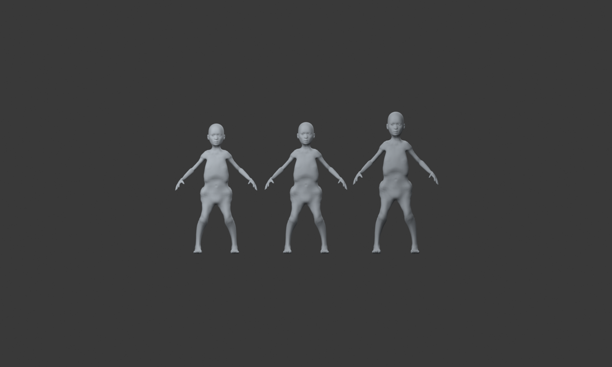
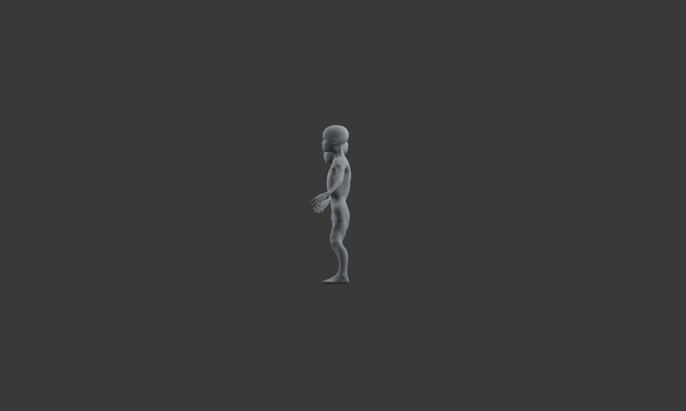
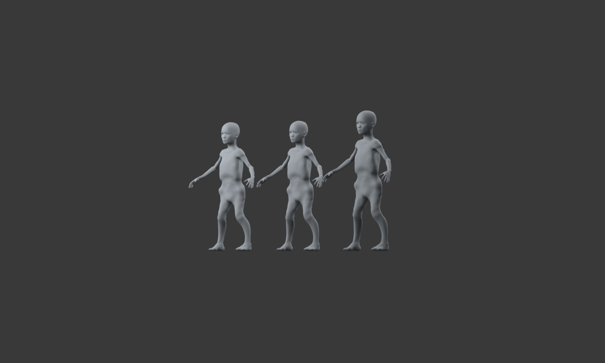

# MB-004B — Child Proportions & Rig Feasibility

**Status:** **PARTIAL / NO-GO for age-proportion approval**
**Branch:** `mb-004b/child-proportion-rig-validation`
**Start head:** `917680909985f4ad2580871aecc139be07527bfd` (MB-004)
**Blender:** 5.2.2 LTS, Windows x64
**MPFB2 source mesh:** 2.0.18 feasibility asset from MB-004A
**Visual and rig approval:** pending character-artist and Product Owner review

## Decision

MPFB2's existing human mesh and standard rig are technically editable, can be scaled into the stature range represented by the source records, and deform in Blender at the tested shoulder, elbow, wrist, hip, knee, ankle, finger, and thumb joints. An animated test GLB loaded in the actual MotionBoard viewer and exposed its clip and playback controls.

This is **not a pass for age-appropriate character proportions**. The three `.blend` candidates below are exploratory scale/silhouette probes based on one real NIST record per age band. They retain the same MPFB body proportions; the source measurements were not applied as local anatomy changes to the head, torso, limb segments, hands, or feet. The reference's stylized proportions also differ from a neutral anthropometric body. MPFB2's generic `child` anchor does not establish a specific age. A character artist must adapt and review the mesh before a candidate can be called a plausible 7–9-year-old schoolboy.

The existing mesh has 784 boundary edges in 28 open boundary loops. Blender's glTF exporter reduces skin influences to four per vertex; the measured pose comparisons show localized differences, including up to 15.2 mm at the elbow test. The rig is a useful prototype, but topology and deformation are not approved for production.

## Legal and anatomical references

### NIST/CPSC AnthroKids 1977

The primary reference is the [NIST AnthroKids database](https://math.nist.gov/~SRessler/anthrokids/ncontent.htm), which describes a CPSC child-measurement study and makes the 1977 subject data available in CSV. The measurement source is the report *Anthropometry of Infants, Children, and Youths to Age 18 for Product Safety Design*, UM-HSRI-77-17, May 1977; see the [measurement index](https://math.nist.gov/~SRessler/anthrokids/datatoc77.htm) and [measurement procedures](https://math.nist.gov/~SRessler/anthrokids/data1977/descrip.htm).

NIST's page describes the database as public domain. Only aggregate ratios and anonymized representative measurement vectors are committed here; the subject-level CSV was downloaded for calculation to a temporary directory and was not added to Git. Temporary source file SHA-256: `1104EA31A490761CB1FD06CD9A66DFC5A8E5A3BBEAD1D4ABB5280BB8D6BDCD7C`.

The data are historical U.S. measurements from 1977, not an Algerian population reference and not clinical or medical guidance. They can bound an initial design discussion, but cannot establish an individual Algerian child's expected proportions. NIST also cautions that separately combined medians do not create an “average child.” To avoid constructing a fictional body by combining unrelated segment percentiles, each candidate reference vector below comes from one real record in its age band; no subject identifier is stored.

### Age-band ratio summary

Ratios below are calculated per subject from the 1977 individual data, then summarized across ages 84–119 months (the database's 7–9-year bands). P05/P50/P95 are percentiles of the per-subject ratio, not the ratio of independent percentile values. Measurement counts differ because the original data contain missing measurements. Values are descriptive only.

| Measurement / proxy | N | P05 | P50 | P95 | Source measure / caveat |
| --- | ---: | ---: | ---: | ---: | --- |
| Head height / stature | 221 | 13.38% | 14.64% | 15.99% | Menton-to-vertex head height / standing stature |
| Erect sitting height / stature | 708 | 50.84% | 53.33% | 55.46% | Seat surface to vertex / standing stature |
| Torso proxy / stature | 217 | 35.90% | 38.53% | 40.71% | (Erect sitting height − head height) / stature; only a proxy, not a directly measured standing torso segment |
| Shoulder breadth / stature | 694 | 22.15% | 24.05% | 26.58% | NIST shoulder breadth; not directly interchangeable with an MPFB bone span |
| Shoulder-to-elbow / stature | 693 | 19.50% | 20.59% | 21.57% | Shoulder-elbow length |
| Elbow-to-fingertip / stature | 693 | 25.15% | 26.36% | 27.82% | NIST elbow-hand length ends at the middle fingertip; it is not a forearm-only measure |
| Combined arm proxy / stature | 692 | 44.98% | 46.98% | 48.97% | Shoulder-elbow + elbow-hand lengths from the same subject; overlap/landmarks differ from a rig-bone chain |
| Subischial proxy / stature | 708 | 44.54% | 46.67% | 49.16% | (Stature − erect sitting height) / stature; approximate, not a direct leg-length measurement |
| Trochanteric height / stature | 218 | 47.87% | 50.33% | 52.97% | Ground to trochanter landmark; a landmark height, not a full leg segment |
| Tibiale height / stature | 220 | 24.23% | 25.79% | 27.62% | Ground to tibiale landmark; a landmark height, not a lower-leg length |
| Hand length / stature | 692 | 10.14% | 10.88% | 11.66% | Wrist crease to middle fingertip |
| Hand breadth / stature | 693 | 4.56% | 5.02% | 5.40% | Across knuckles |
| Foot length / stature | 693 | 14.79% | 15.61% | 16.61% | Heel to longest toe |
| Foot breadth / stature | 693 | 5.50% | 6.07% | 6.64% | Maximum width at ball of foot |

### Candidate reference vectors

For each band, a complete record was selected from the subset with all of stature, sitting height, head height, shoulder breadth, shoulder-elbow, elbow-hand, hand length, and foot length present. The selected record minimizes standardized distance from that age band's median ratio profile. The values are kept as one record vector and contain no subject number.

| Candidate label | Source band | Stature | Head / stature | Sitting height / stature | Shoulder breadth / stature | Shoulder-elbow / stature | Elbow-hand / stature | Hand / stature | Foot / stature |
| --- | --- | ---: | ---: | ---: | ---: | ---: | ---: | ---: | ---: |
| Candidate 01 | 84–95 months (7-year band) | 127.8 cm | 14.95% | 54.69% | 24.57% | 20.81% | 26.13% | 10.72% | 15.57% |
| Candidate 02 | 96–107 months (8-year band) | 129.2 cm | 14.40% | 53.33% | 24.46% | 20.51% | 26.55% | 10.68% | 15.63% |
| Candidate 03 | 108–119 months (9-year band) | 139.4 cm | 13.99% | 52.87% | 23.46% | 20.52% | 26.90% | 10.98% | 16.00% |

These are exploratory reference vectors, not age norms and not validated MotionBoard proportions. The `.blend` files use the source stature and small global axis factors derived from shoulder-breadth and foot-length ratios to expose scale sensitivity. **They do not locally reshape those anatomy regions to match the listed ratios.**

## MPFB2 candidate artifacts

All three files are copies of the same editable MPFB2 hm08 child-anchor base and standard rig. Candidate identity and reference ratios are stored as custom properties on the mesh. They have no hair, clothing, shoes, flag, or educational animation.

| Artifact | Description |
| --- | --- |
| [`candidate 01`](../production/blender/mb004b/candidates/mb004b-candidate-01-84m-exploratory.blend) | 7-year-band stature/silhouette scale probe |
| [`candidate 02`](../production/blender/mb004b/candidates/mb004b-candidate-02-96m-exploratory.blend) | 8-year-band stature/silhouette scale probe; used for rig and GLB checks |
| [`candidate 03`](../production/blender/mb004b/candidates/mb004b-candidate-03-108m-exploratory.blend) | 9-year-band stature/silhouette scale probe |
| [`candidate reference vectors`](../production/blender/mb004b/candidate-reference-vectors.json) | Anonymized vector values used by the scale probes |
| [`candidate generation script`](../production/blender/mb004b/create_candidates.py) | Rebuilds the editable probes and comparison renders from the MB-004A base |

Front, side, and three-quarter comparisons show the three probes left-to-right in increasing age band:

| Front | Side | Three-quarter |
| --- | --- | --- |
|  |  |  |

These are neutral gray Blender renders of the same MPFB body. They are technical comparison images, not a character-design presentation or visual approval.

## Topology and rig checks

### Boundary edges

The candidate mesh contains 19,158 vertices, 37,364 edges, and 18,486 polygons. A BMesh audit found 784 boundary edges in 28 connected boundary loops, no wire edges, and no zero-area faces in the MB-004A source audit. Boundary zones below are approximate classifications from normalized vertex height and loop centroids, not semantic labels from MPFB.

| Approximate zone | Boundary loops | Boundary edges |
| --- | ---: | ---: |
| Head / face | 23 | 654 |
| Torso / arm root | 3 | 60 |
| Pelvis / thigh | 1 | 34 |
| Foot / toe | 1 | 36 |
| **Total** | **28** | **784** |

The loops cluster around the face/head, with additional open boundaries at torso/arm-root, pelvis/thigh, and foot/toe locations. This audit identifies and localizes open boundaries; it does not prove they are deliberate anatomical openings or acceptable production seams. The mesh is not watertight. A topology artist must inspect and classify each loop before production use.

### Articulation and grasp support

The MPFB standard rig has deform bones for both hands, including a thumb chain and articulated finger chains. The probe posed one bone for each target joint and compared evaluated vertices against the neutral pose. Each tested pose moved vertices by more than 1 mm, so Blender's armature modifier is active and connected for these joints.

| Joint probe | Tested bone | Maximum vertex movement in Blender | Result |
| --- | --- | ---: | --- |
| Shoulder | `upperarm02.L` | 121.9 mm | Moved |
| Elbow | `lowerarm02.L` | 144.5 mm | Moved |
| Wrist | `wrist.L` | 25.4 mm | Moved |
| Hip | `upperleg02.L` | 55.5 mm | Moved |
| Knee | `lowerleg02.L` | 123.1 mm | Moved |
| Ankle | `foot.L` | 22.8 mm | Moved |
| Finger | `finger2-1.L` | 29.4 mm | Moved |
| Thumb | `finger1-1.L` | 31.9 mm | Moved |

The values only establish that the rig deforms geometry; they are not quality ratings. The technical pose render is available as [`rig test pose`](../production/blender/mb004b/mb004b-rig-test-pose.png), with a neutral comparison at [`rig test rest`](../production/blender/mb004b/mb004b-rig-test-rest.png). Finger and thumb bones support a future grasp study, but natural finger shape, contact, and grasp silhouettes remain unreviewed.

### glTF four-joint limit

The Blender source has 19,158 mesh vertices. **11,334 vertices (59.2%) have more than four non-zero bone influences.** The probe normalized each vertex's weights, retained its four strongest influences, and compared the resulting posed mesh against the full-weight pose.

- Maximum discarded normalized weight on a vertex: **20.59%**.
- Mean discarded normalized weight among over-limit vertices: **6.19%**.
- Across the joint probes, maximum per-vertex difference after top-four reduction ranged from **1.42 mm (finger)** to **15.20 mm (elbow)**; mean differences across all vertices ranged from 0.001 to 0.041 mm.

This indicates the global average is small but localized differences reach centimeter scale at the elbow and knee in these probes. It is a meaningful limitation for close-up animation. The exporter warning is expected; reduce/paint weights and review the affected deformations before production.

## GLB and actual browser test

The test GLB [`mb004b-rig-probe.glb`](../assets/test-only/mb004b-rig-probe.glb) is a local-only technical fixture derived from the MPFB2 core mesh. SHA-256: `28AFAD8D3D04AF93FE25CAD899A581BBB87C4328D23A96386298A15B14EF6D0C`; size: **7,632,716 bytes**. It contains one skinning test clip named `MB004B_RIG_TEST_NOT_EDUCATIONAL` (frames 1–105 at 30 fps, approximately 3.47 seconds). It poses shoulder, elbow, wrist, hip, knee, ankle, finger, and thumb one at a time; it is not an educational movement.

**Actual browser evidence:** loaded through the Vite development-only route `http://127.0.0.1:4175/?testAsset=mpfb2-rig-probe` in the open Codex in-app browser at approximately 863 × 637 CSS pixels. The viewport displayed the loaded human mesh, material, local filename, clip name, and Arabic RTL interface. The viewer showed the animation and I exercised pause, play, restart, loop on/off, 0.25×, 0.5×, 1×, pointer drag orbit, wheel zoom, and camera reset. Each speed and loop action produced the expected selected state; orbit, zoom and reset changed the visible framing. Only one clip exists, so multi-clip selection was unavailable. The browser rendered the articulated rig-test clip, but visible stretching/clipping remained in some poses; this is a deformation warning, not a pass for rig quality.

Browser console logs and GPU/WebGL warning logs were not exposed by the connected in-app browser controls, so they are **not tested**. Browser memory/disposal behavior and repeated asset swapping were also **not tested**. Blender successfully exported and re-imported the GLB with its skin and the single test action.

### Reproduction in the app

From the repository root, use Blender 5.2.2 with the candidate scripts and start the development server:

```powershell
$profile = Join-Path $env:TEMP 'motionboard-mpfb2-isolated'
$env:BLENDER_USER_CONFIG = Join-Path $profile 'config'
$env:BLENDER_USER_SCRIPTS = Join-Path $profile 'scripts'
$env:BLENDER_USER_DATAFILES = Join-Path $profile 'datafiles'
& 'C:\path\to\blender.exe' --background --python 'production/blender/mb004b/create_candidates.py'
& 'C:\path\to\blender.exe' --background --python 'production/blender/mb004b/validate_rig_export.py'
npm run dev -- --host 127.0.0.1 --port 5173
```

Open `http://127.0.0.1:5173/?testAsset=mpfb2-rig-probe`. The probe path is development-only. The fixture remains explicitly labeled non-educational and does not claim an approved character.

## Verification results

| Check | Result | Evidence / notes |
| --- | --- | --- |
| Blender 5.2.2 runtime | PASS | Background process opened, rendered, rigged, exported and re-imported the files |
| MPFB2 provenance | PASS | MB-004A base mesh created using MPFB2 2.0.18 official package; this task reused the committed source mesh |
| Age-related reference | PARTIAL | Public, documented historical child data is available; it is not Algerian-specific or a clinical standard |
| Three candidate Blender files | PARTIAL | Editable scale/silhouette probes exist; local anatomy was not remapped to age-band ratios |
| Front / side / three-quarter renders | PASS | Three comparison PNGs generated; technical only |
| Boundary-edge classification | PARTIAL | All 784 edges localized into 28 approximate region groups; semantic/open-seam acceptability needs an artist |
| Blender joint deformation | PASS for movement only | All eight tested regions moved geometry; no quality approval implied |
| Hand / thumb rig presence | PASS for controls present | MPFB includes digit chains; grasp quality not assessed |
| Four-joint effect | PARTIAL / defect identified | 59.2% vertices over limit; local top-four pose deltas reach 15.20 mm |
| Blender GLB export / round trip | PASS with deformation limitation | 7,626,584 bytes; one named technical action |
| MotionBoard browser load and controls | PASS for load and controls; deformation FAIL / review required | Actual desktop in-app browser load and orbit/zoom/reset/playback controls; joint probe rendered with visible mesh stretching/clipping |
| Browser console / memory cleanup | NOT TESTED | Current in-app browser control did not expose console logs or memory instrumentation |
| TypeScript | PASS | `npm run typecheck` |
| JSON Schemas | PASS | `npm run validate` — 5 schema tests passed |
| Automated tests | PASS | `npm test` — 16 tests passed |
| Production build | PASS with warning | `npm run build`; Vite reported a 564.72 kB Viewer chunk above its 500 kB advisory threshold |

## Asset provenance and licensing

- Base geometry and shape targets: MPFB2 2.0.18 bundled hm08 human base asset; MB-004A documents the official package checksum and isolated installation. MPFB's [asset license](https://github.com/makehumancommunity/mpfb2/blob/v2.0.18/LICENSE.ASSETS.md) identifies core graphics assets as CC0; MPFB add-on code is GPL-3.0-or-later. No separate downloaded asset pack was introduced.
- Anthropometry: NIST AnthroKids states its child data are public domain; only derived numeric summaries are stored here. The source file was not included.
- Reference art: the user-provided schoolboy image remains outside this repository and was not used as geometry or copied into artifacts.
- No final MotionBoard character, clothing, shoes, Algerian flag, or educational movement was produced.

## Remaining blockers and recommendation

1. A character artist must perform local, joint-aware proportion adaptation and judge the neutral human shape against the supplied reference. These scale probes do not meet that gate.
2. The 784 boundary edges and their 28 loops need semantic topology review and repair decisions.
3. The MPFB rig weights need cleanup for glTF's four-influence limit, followed by reviewed poses at representative joint extremes.
4. Browser console/GPU warnings and repeated asset cleanup need a browser environment exposing those diagnostics.
5. Product Owner visual and rig approval remains pending.

**Recommendation: PARTIAL / NO-GO for final character work or educational animation production.** MPFB2 can provide a manipulable starting mesh and rig, but this run does not establish age-plausible 7–9-year proportions or production-ready deformation. Continue only with a qualified character artist reviewing actual Blender files and renders.
