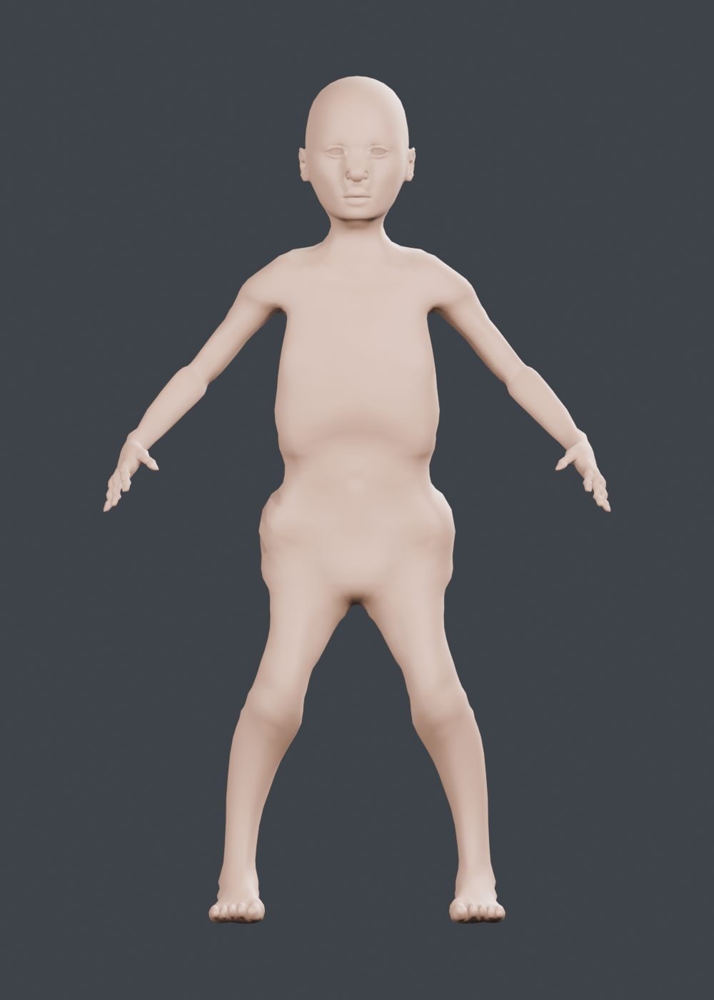
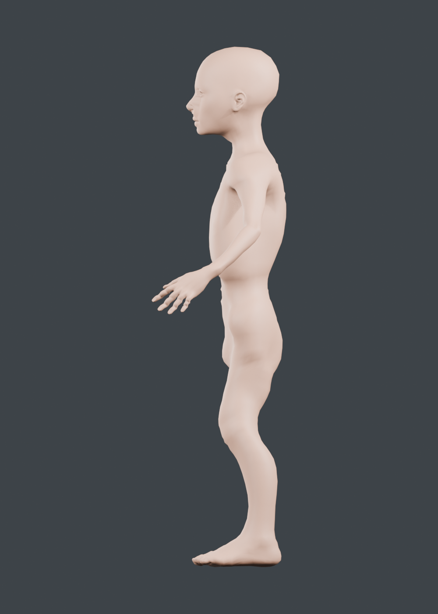
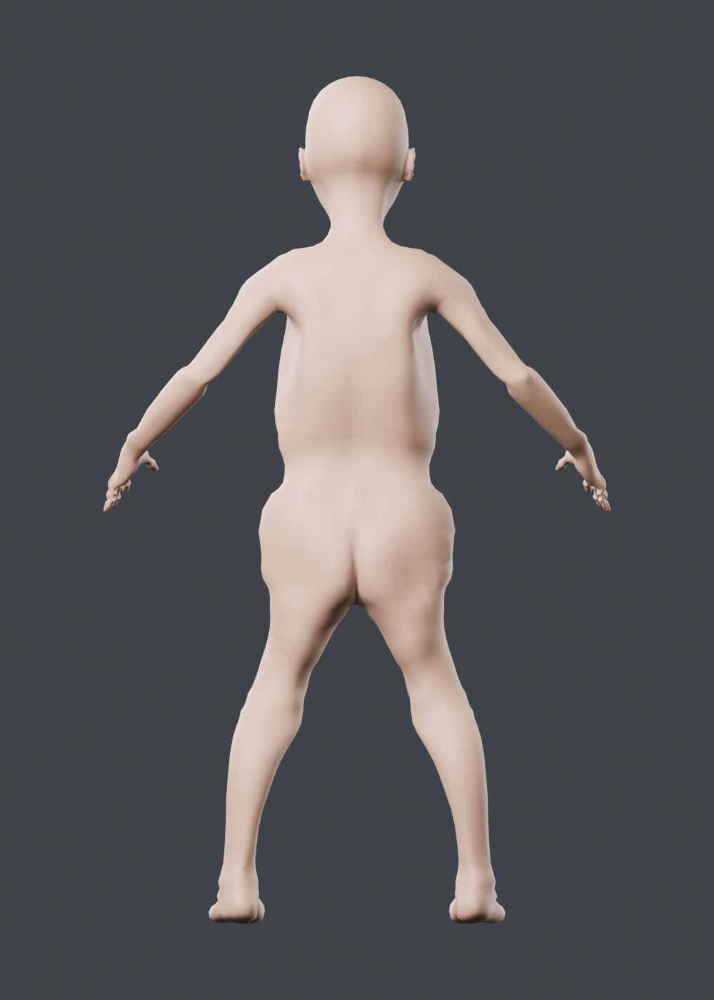
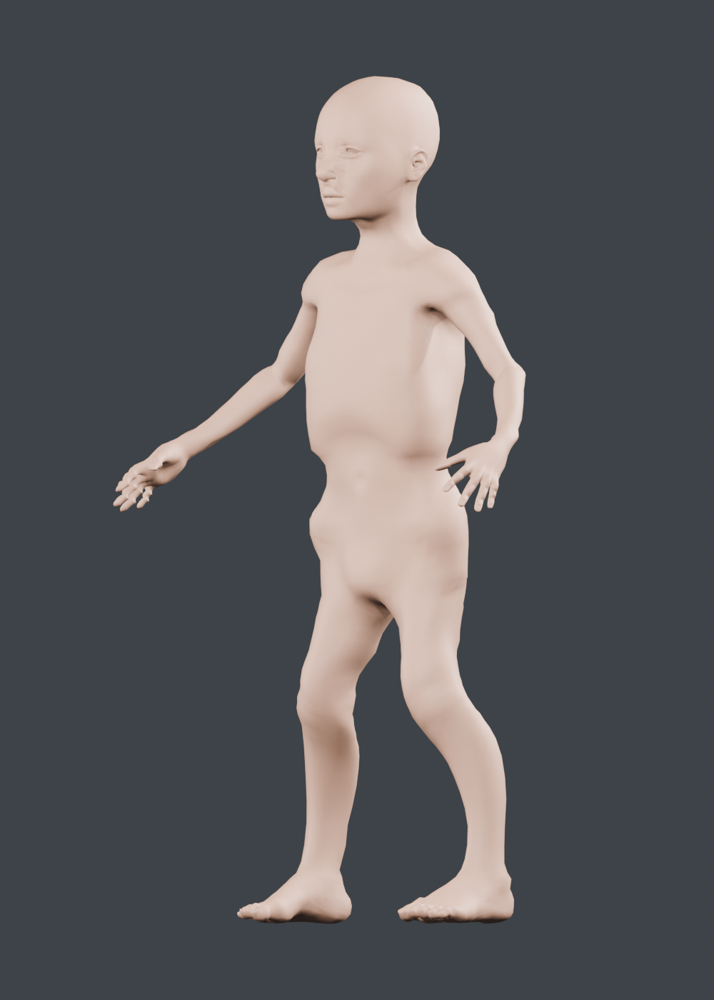
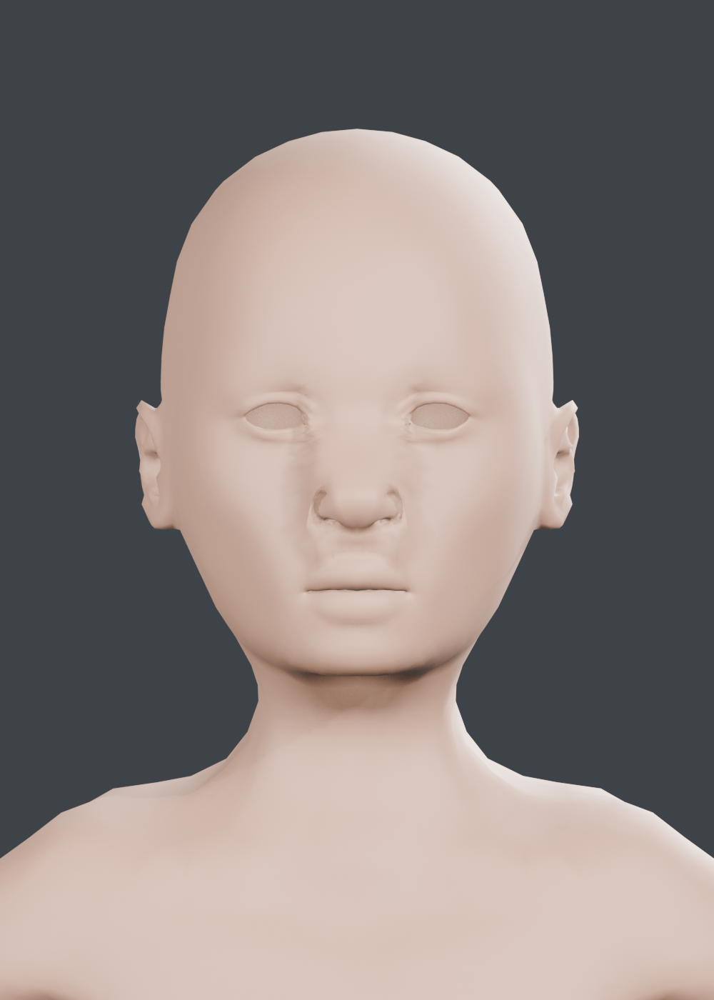

# MB-006 — Anatomy & Face Prototype Review

**Result:** PARTIAL — editable MPFB2-based prototype with real local shape-key edits. It does not meet the visual acceptance criteria for a convincing semi-realistic school-age character. Product Owner and character-artist approval remain pending.

**Branch:** `mb-006/child-anatomy-face-prototype`

**Base:** `mb-005a/character-candidate-evaluation` at `cef659092f96017a9da48121650607ebbe57f1cd`

**Blender:** 5.2.2 LTS, Windows x64

**MPFB2 base:** 2.0.18 bundled `hm08` child anchor; core geometry/targets identified as CC0 in [MB-004A feasibility](MB-004A_MPFB2_FEASIBILITY.md).

**Reference:** user-supplied MotionBoard concept image at `C:\Users\ous\Downloads\a_clean_studio_rendered_character_design_model_sh.png`; used only for art direction and not redistributed.

## Decision

The editable source is a real MPFB2 human mesh, not a primitive assembly. It preserves the original 19,158-vertex mesh, armature and mask modifier, and adds a shape key with localized shoulder, chest, waist, pelvis, neck, cheek, jaw, finger and forefoot edits. The six images below were rendered from that Blender scene.

The prototype is **not visually convincing enough** for the requested target. It remains a hairless, untextured base with blank eye surfaces, a neutral expression, a visibly generic face, an awkward A-pose and conspicuously rounded torso/hip volumes. The three-quarter image exposes the source rig's asymmetric arm pose. The edits are measurable but subtle and do not resolve those principal visual issues. No limb lengths or joint locations were locally changed. No final uniform, shoes, flag, hair, facial details, or educational animations were made.

**GO/NO-GO:** NO-GO for final character production, use in the gallery, and animation production from this prototype. The source is suitable only as a draft sculpting study. A character artist must first make substantial face and silhouette changes and inspect the inherited mesh openings and rig. Do not call it age-validated: a single 96–107 month NIST/CPSC record was used only as scene-scale context, not as proof of age suitability or as an Algerian child template. Visual and rig sign-off remain with the Product Owner and qualified reviewers.

## Actual Blender renders

These are the requested images rendered directly by Blender 5.2.2 from the editable mesh. They document the current draft, not an approved character design.

| View | Render |
| --- | --- |
| Front |  |
| Side |  |
| Rear |  |
| Three-quarter |  |
| Face close-up |  |
| Full-body neutral |  |

## Geometry edits and proportion comparison

Edits are stored in `MB006_LocalAnatomy_Prototype` relative to the MPFB2 `Basis` key. The configured peak values below are local width/depth changes applied smoothly by height band and existing vertex-group weights; they are not measured anatomical ratios.

| Region | Prototype change at peak | Limitation |
| --- | ---: | --- |
| Shoulder band width | +7.5% | Does not reposition shoulder joints or establish an age-specific breadth. |
| Upper chest width | +2.5% | Silhouette remains broad and generic in the render. |
| Waist width | −4.5% | Localized width reduction only. |
| Pelvis width | −3.5% | Localized width reduction only; does not repair the visible hip/crotch silhouette. |
| Neck depth | +3.5% | Does not change neck length or rig landmarks. |
| Cheek width / lower jaw width | +2.5% / −2.0% | Small face edits; no eye, nose, lip, ear or expression sculpting. |
| Finger extension / forefoot length | +3.5% / +2.5% | Small shape changes only; no grasp or footwear evaluation. |
| Head/body ratio, limb lengths, joint locations | No local change | Not validated against age-band measures. |

The MPFB2 scene's base body height was 1.0054 scene units before armature-only scene scaling. For render framing, the rig was uniformly scaled by 1.2851 to set 1.292 scene units, matching the stature of the existing NIST/CPSC AnthroKids 1977 Candidate 02 reference vector. This is presentation scale only; it does not alter body proportions and cannot establish that the model looks eight years old. The earlier report's double-multiplied displayed height was corrected before the final six renders.

The contextual reference vector is one anonymized record in the 96–107 month band: head/stature 14.40%, sitting-height/stature 53.33%, shoulder breadth/stature 24.46%, shoulder–elbow/stature 20.51%, elbow–hand/stature 26.55%, hand/stature 10.68%, and foot/stature 15.63%. See [MB-004B](MB-004B_VERIFICATION.md) for source and caveats. No claim is made that this mesh matches these ratios; the NIST record is historical U.S. data, not an Algerian norm or medical standard.

## Technical inspection

| Check | Result |
| --- | --- |
| Editable Blender source | PASS — shape keys, mesh, armature and modifiers retained in the `.blend`. |
| Actual local geometry edits | PASS — nonzero shape-key displacement is stored on the mesh. |
| Mesh inventory | 19,158 vertices, 37,364 edges, 18,486 polygons in the base mesh data. |
| Modifiers | `ARMATURE`, `MASK` retained. |
| Boundary topology | 784 boundary edges in 28 loops, inherited from the MPFB2 source as audited in MB-004A/004B; not repaired or reclassified in this task. The mesh is not watertight. |
| Rig alignment | Existing standard rig retained. This task did not pose-test the joints or verify alignment after the local edits. |
| Neutral pose | Existing A-pose retained; not approved as production neutral. |
| Four-joint glTF limit | Inherited limitation described in MB-004B; no GLB export was made for MB-006. |
| Runtime/browser | Not tested; no export or viewer integration was requested. |
| External asset packs | None added. Temporary evaluation material is authored in the build script and has no external texture dependency. |

## Files

- [Editable Blender prototype](../production/blender/mb006/mb006-child-anatomy-prototype.blend)
- [Rebuild/render script](../production/blender/mb006/build_child_anatomy_prototype.py)
- [Machine-readable prototype report](../production/blender/mb006/mb006-prototype-report.json)
- Six Blender renders in `production/blender/mb006/`

## Reproduction and checks

The script opens the committed MPFB2 base, creates the local shape key, applies temporary render materials and studio cameras/lights, renders six PNGs, saves the editable `.blend`, and writes the JSON report. It does not modify the MPFB2 source file.

Run in PowerShell from the repository root with Blender 5.2.2 installed. To isolate Blender preferences from the user's regular profile:

```powershell
$profile = Join-Path $env:TEMP 'motionboard-mpfb2-isolated'
$env:BLENDER_USER_CONFIG = Join-Path $profile 'config'
$env:BLENDER_USER_SCRIPTS = Join-Path $profile 'scripts'
$env:BLENDER_USER_DATAFILES = Join-Path $profile 'datafiles'
$env:BLENDER_USER_EXTENSIONS = Join-Path $profile 'extensions'
$blender = 'C:\path\to\blender.exe'
& $blender --background --factory-startup --python production/blender/mb006/build_child_anatomy_prototype.py
```

The completed production run exited successfully under Blender 5.2.2 LTS and saved all six PNGs, the editable `.blend`, and JSON report. Blender emitted two API deprecation warnings (`Material.use_nodes` and `World.use_nodes`) for Blender 6.0; no render failure occurred. The saved file was reopened in background Blender to inspect object dimensions, shape-key state, mesh counts, modifiers and armature scale.

No npm tests, GLB export, browser test, extensive rig test, or educational animation test was run. This task does not claim those results.

## Remaining work and approval

1. Product Owner reviews the six actual renders and decides whether to continue with this base.
2. If continued, a character artist must revise the face and body silhouette, assess age appearance with defensible references, and resolve or explicitly accept the open-boundary topology.
3. Recheck rig alignment and joint deformation only after those geometry revisions.
4. Keep visual and technical approval pending until reviewers record their decisions.

No SPEX TECH files were accessed or changed. No final character, garment, shoes, flag, GLB, or educational movement was produced.
